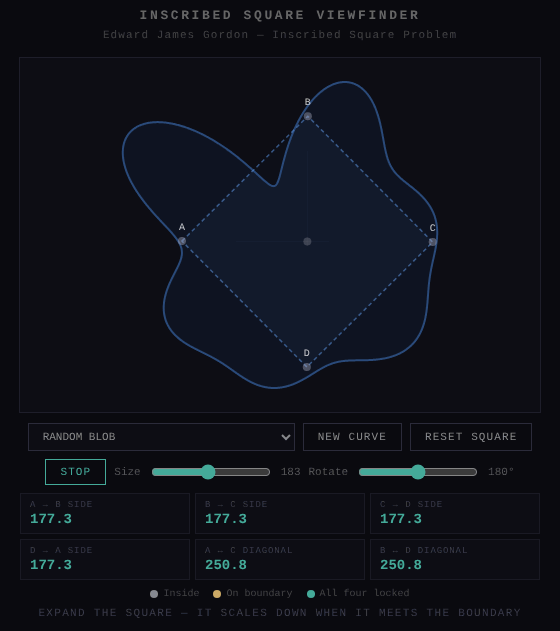
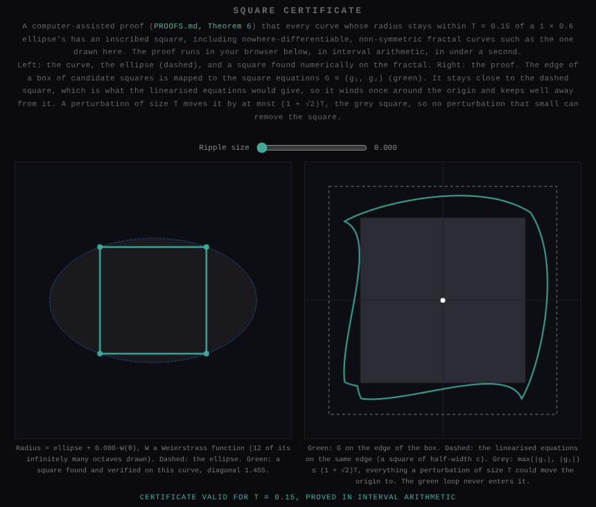
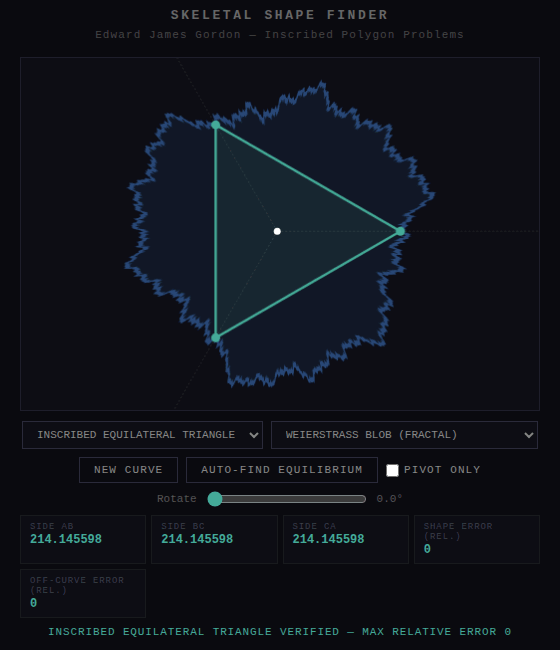
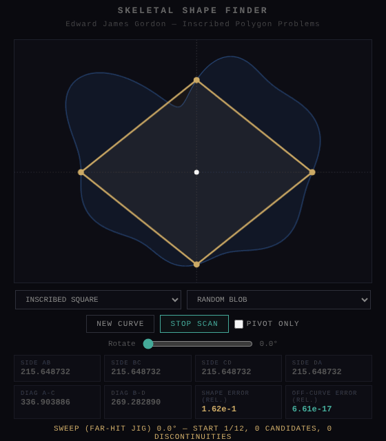
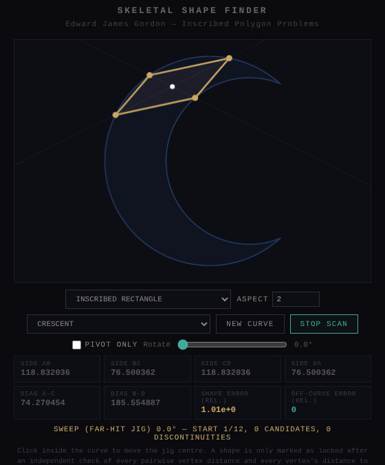
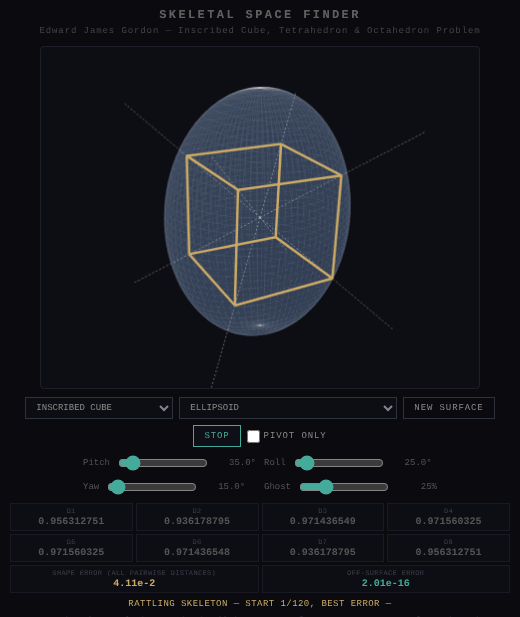
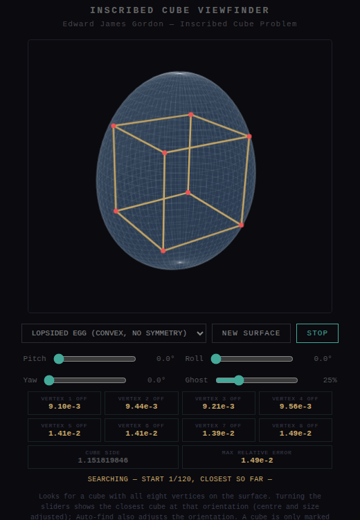
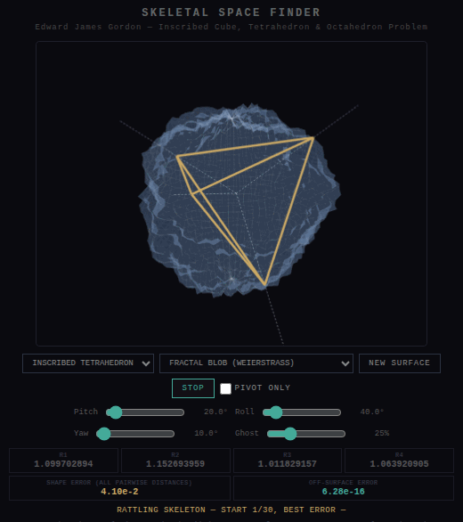

# Inscribed Problems
This project presents **conjectures** and a skeletal constraint-based search, a "rattling frame" construction, intended as evidence and motivation for the conjecture that a state of mechanical equilibrium exists for all continuous, non-self-intersecting 2D or 3D volumes (containing a regular triangle, square, regular tetrahedron, and cube).

**Status.** The conjectures for general continuous Jordan curves / surfaces are **open problems** in the literature. The 2D inscribed-square case is the Toeplitz conjecture: open for general continuous curves, and proved for convex curves (Emch), smooth curves (Schnirelmann) and locally monotone curves, which include all polygons (Stromquist 1989). The 3D inscribed-tetrahedron case is proved for smooth ($C^1$) surfaces, in every orientation (Gromov 1969), and open for general continuous surfaces. The 3D inscribed-cube conjecture is **false** for generic surfaces, even smooth convex ones ([PROOFS.md](PROOFS.md), Theorem 1); it holds for centrally symmetric convex bodies (Hausel–Makai–Szűcs 2000). The arguments below are **proposed proofs of conjectures**, not established results, except where marked. See the [problem map](#problem-map), [PROOFS.md](PROOFS.md) and [References](#references).

This repository also contains some other proposed arguments of mine.

## Interactive Demonstration
You can view the **Inscribed Square & Cube Viewfinder** in action here:
[Run the Live Viewfinder](https://thor110.github.io/InscribedShapeProblems/)

Note that the viewfinders are simpler demonstrations, while the skeletal finders more accurately showcase the method.

### What the finders do

- **Skeletal Shape Finder (2D).** A jig of rays from a common centre $I$ grips the curve. The rays point at the target shape's vertices as seen from its circumcentre, so the hit points form the target exactly when every ray has the same length. Targets: square, rectangle of any aspect ratio, equilateral triangle, triangle of any shape, regular pentagon and regular hexagon. The centre is "rattled" toward the chord midpoints, then Newton's method solves the equilibrium to machine precision. For the square the jig sweeps its rotation looking for the sign change in the diagonal difference (the IVT step). If that sweep fails, it tries a nearest-hit jig, then random restarts, then a *tracking* jig whose arms follow a chosen crossing. The tracking jig is needed on curves that are not star-shaped, where a square's vertex can be a middle crossing of a ray.
- **Skeletal Space Finder (3D).** The same idea with rays along the cube diagonals, the tetrahedral directions or the octahedral axes. A Levenberg–Marquardt solver adjusts the centre (3 DoF) and rotation (3 DoF) to make every ray length equal. On fractal surfaces it solves a smoothed surface first and adds detail one octave at a time.
- **Pivot only.** Both skeletal finders have a *Pivot only* checkbox. It keeps the skeleton's rotation fixed and only jiggles the central pivot, which isolates the bisection step. An equilateral triangle (2D) or regular tetrahedron (3D) is still found at any rotation, because centring alone forces equal ray lengths. A square, cube or octahedron generally is not, because it needs the rotation as well.
- **Inscribed Cube Viewfinder.** Searches directly for a cube with all eight vertices on the surface, adjusting centre, rotation and size (7 parameters for 8 vertex conditions). Moving the sliders shows the closest cube at that orientation. (Earlier versions grew the largest cube that fits *inside* the surface, which is a different problem.)
- **Search time estimates.** Each finder shows an estimated search time for the chosen shape and curve or surface, plus elapsed time and remaining time while it runs. Where no exact solution is expected, such as a cube on a surface without symmetry or a square with its rotation held fixed, the estimate is **∞**. The search still runs through its set number of starting points and then reports the closest candidate.
- **Curves:** smooth blobs, star, circle (a control on which every target exists), ellipse, polygons, a true crescent, a comb, a spiral (not star-shaped from any point), and the fractals: Koch snowflake (12,288 edges), hexagonal anti-snowflake, Minkowski island (16,384 edges), Weierstrass blob and a random fractal coastline. `tests/jordan-check.js` confirms each is a simple closed curve.
- **Surfaces:** sphere, ellipsoid, a lopsided egg (strictly convex, no symmetry), random blob, bumpy sphere, 3D star, heart-like, ring-like, cube-like, and two fractal surfaces. All are seam-free.

### Verification and precision

A shape is marked **locked / verified** only after an independent check. That check compares **every pairwise vertex distance** with the ideal shape, and **every vertex's distance to the curve or surface**, against a relative tolerance of $10^{-9}$. Typical verified results are accurate to about $10^{-16}$, the limit of double-precision arithmetic.

Earlier versions could report a lock on the wrong shape:

- The 2D finder forced "locked" after a sign change even when the sign change came from a jump in the chord function (non-convex curves).
- The 3D finder checked only the 4 long diagonals and 12 edges of the cube. Two nested regular tetrahedra of *different* sizes pass that test without being a cube. Its tolerance was also about 0.5%.

The pairwise-distance check rules out both. Every curve and surface is generated from a seed, and the URL records it (`?curve=koch&seed=42`), so any result can be reproduced.



## Problem map

The original four problems ask for an inscribed equilateral triangle, square, regular tetrahedron and cube. The triangle is solved. Each of the other three belongs to a family that continues into every dimension, because the skeletal jig works the same way in $\mathbb{R}^n$:
- **Square:** its jig (two perpendicular chords, bisected and equal) generalises to the **cross-polytope** (octahedron in 3D, 16-cell in 4D), *not* to the hypercube.
- **Cube:** generalises to the hypercube.
- **Tetrahedron:** generalises to the regular simplex.

*Expected dimension* is the number of degrees of freedom of a similar copy, $n(n+1)/2+1$, minus the number of vertices. *Found* is from this repository's verified searches: an inscribed copy whose pairwise distances and surface distances all agree to 1e-9. Test curves and surfaces include fractals, non-convex shapes and a strictly convex surface with no symmetry.

| Family | Shape | Dim | Vertices | Expected dim. | Status in the literature | Proved here | Found by the finders |
|---|---|---|---|---|---|---|---|
| Triangle | Equilateral / any triangle | 2 | 3 | 1 | **Solved** for all Jordan curves (Meyerson 1980, Nielsen 1992) | — | ✅ every curve tested |
| **Square** | Square | 2 | 4 | 0 | **Open** for continuous curves. Proved for convex (Emch), smooth (Schnirelmann), locally monotone (Stromquist), small-Lipschitz (Tao), near-smooth (Chambers) | Every curve within 0.15 of one ellipse, fractals included (Theorem 6, computer-assisted, interval arithmetic) | ✅ every curve tested (16 + 3 in the n-D engine) |
| Square | Rectangle, any aspect ratio | 2 | 4 | 0 | **Open** for continuous curves. Proved for smooth (Greene–Lobb 2021); *some* aspect ratio always exists (Vaughan) | — | ✅ every curve tested |
| Square | Regular pentagon, hexagon, … | 2 | 5, 6, … | < 0 | Known to fail in general (e.g. ellipses) | Theorem 1 (generic) | ✅ only on curves with matching symmetry |
| Square | Regular octahedron | 3 | 6 | 1 | **Open.** Proved for smooth convex bodies (Makeev 2001) | — | ✅ every surface tested |
| Square | Cross-polytope (16-cell, …) | 4, 5 | 8, 10 | 3, 6 | **Open.** Proved for smooth convex bodies when $n$ is an odd prime power (Karasev 2009) | — | ✅ every surface tested (5 surfaces × 2 seeds in each dimension) |
| **Cube** | Cube | 3 | 8 | **−1** | Proved for centrally symmetric convex bodies (Hausel–Makai–Szűcs 2000) | **False in general** (Theorem 1) | ❌ except on symmetric surfaces |
| Cube | Hypercube | 4, 5 | 16, 32 | −5, −16 | — | **False in general** (Theorem 1) | ✅ only on the sphere and ellipsoid; ❌ elsewhere (closest misses 0.6–9%) |
| Cube | Icosahedron, dodecahedron | 3 | 12, 20 | −5, −13 | — | **False in general** (Theorem 1) | not tested |
| **Tetrahedron** | Regular tetrahedron | 3 | 4 | 3 | **Open** for continuous surfaces. Proved for $C^1$ surfaces in every orientation (Gromov 1969) | Every orientation in every smooth convex body; admissible orientations in every convex body (Theorems 2–3); not every orientation in sharp bodies (Proposition 5); every surface within 0.13 of one ellipsoid, rough ones included, with an open set of orientations (Theorem 7, computer-assisted, interval arithmetic) | ✅ every surface tested, at any rotation |
| Tetrahedron | Regular simplex (5-cell, …) | 4, 5 | 5, 6 | 6, 10 | **Open** for continuous; proved for $C^1$ (Gromov) | Theorems 2–3 (convex, every dimension) | ✅ every surface tested (5 surfaces × 2 seeds in each dimension) |

**Where the three open problems stand.**
1. **Square:** open. Every test agrees with the conjecture, including the [shrinkage study](#square-shrinkage-study-and-rectangle-sweep): on ever-rougher fractals the largest square converges rather than shrinking. The jig argument is a proof for convex curves (Emch's); for non-convex curves the step "the bisecting centre moves continuously as the jig rotates" fails, and that gap is the open problem.
2. **Tetrahedron:** solved for smooth surfaces (Gromov), so what remains open is non-smooth (merely continuous) surfaces. The [3D shrinkage study](#square-shrinkage-study-and-rectangle-sweep) finds the tetrahedra converging, not shrinking, as surfaces get rougher. The centring jig gives elementary proofs ([PROOFS.md](PROOFS.md)):
   - **Theorem 2:** every smooth strictly convex body, in every orientation and every dimension.
   - **Theorem 3:** every convex body, in every *admissible* orientation (one where, from every boundary point, some arm of the jig points strictly into the body). This includes every orientation for any convex body with a smooth boundary, flat pieces allowed.
   - **Proposition 5:** for non-smooth bodies "every orientation" can genuinely fail. A triangle with an apex sharper than 60° has no inscribed equilateral triangle pointing at its apex, and the 60° bound is sharp (`node tests/check-orientations.js`).
3. **Cube:** settled in the negative for general surfaces ([PROOFS.md](PROOFS.md), Theorem 1): a cube has 7 degrees of freedom but 8 vertex conditions, so generic surfaces have none. The same holds for every hypercube in dimension ≥ 3.

<details><summary>Full n-dimensional results (seed 1; ✅ verified with its error, ❌ closest miss)</summary>

| n | Shape | Vertices | Expected dimension | Sphere | Ellipsoid | Lopsided egg | Random blob | Fractal blob | Literature |
|---|---|---|---|---|---|---|---|---|---|
| 2 | equilateral triangle | 3 | 1 | ✅ 6e-17 | ✅ 3e-16 | ✅ 1e-16 | ✅ 2e-16 | ✅ 1e-16 | Solved for all Jordan curves (Meyerson 1980; Nielsen 1992) |
| 2 | square | 4 | 0 | ✅ 0e+0 | ✅ 2e-16 | ✅ 3e-16 | ✅ 4e-16 | ✅ 6e-16 | Open for continuous curves; proved for smooth (Schnirelmann), convex (Emch), locally monotone (Stromquist) |
| 3 | regular tetrahedron | 4 | 3 | ✅ 4e-16 | ✅ 1e-16 | ✅ 5e-16 | ✅ 3e-16 | ✅ 3e-16 | Open for continuous; proved for C¹ spheres in every pose (Gromov 1969) |
| 3 | regular octahedron | 6 | 1 | ✅ 0e+0 | ✅ 9e-16 | ✅ 8e-16 | ✅ 8e-16 | ✅ 5e-16 | Open; proved for smooth convex bodies (Makeev 2001) |
| 3 | cube | 8 | -1 | ✅ 0e+0 | ✅ 4e-16 | ❌ 2e-2 | ❌ 9e-3 | ❌ 2e-4 | False for generic smooth surfaces (PROOFS.md); true for centrally symmetric convex bodies (Hausel–Makai–Szűcs 2000) |
| 4 | regular 5-cell | 5 | 6 | ✅ 1e-16 | ✅ 5e-16 | ✅ 6e-16 | ✅ 4e-16 | ✅ 4e-16 | Open for continuous; proved for C¹ spheres in every pose (Gromov 1969) |
| 4 | regular 16-cell | 8 | 3 | ✅ 0e+0 | ✅ 7e-16 | ✅ 1e-15 | ✅ 1e-15 | ✅ 1e-15 | Open; proved for smooth convex bodies when n is an odd prime power (Karasev 2009) |
| 4 | tesseract | 16 | -5 | ✅ 0e+0 | ✅ 1e-15 | ❌ 1e-2 | ❌ 5e-2 | ❌ 1e-2 | False for generic smooth hypersurfaces (PROOFS.md) |
| 5 | 5-simplex | 6 | 10 | ✅ 1e-16 | ✅ 6e-16 | ✅ 4e-16 | ✅ 6e-16 | ✅ 6e-16 | Open for continuous; proved for C¹ spheres in every pose (Gromov 1969) |
| 5 | 5-orthoplex | 10 | 6 | ✅ 0e+0 | ✅ 5e-16 | ✅ 1e-15 | ✅ 2e-15 | ✅ 2e-15 | Open; proved for smooth convex bodies when n is an odd prime power (Karasev 2009) |
| 5 | 5-cube | 32 | -16 | ✅ 1e-16 | ✅ 1e-14 | ❌ 1e-2 | ❌ 6e-2 | ❌ 6e-2 | False for generic smooth hypersurfaces (PROOFS.md) |

</details>

The [Dimension Explorer](https://thor110.github.io/InscribedShapeProblems/pages/dimension-explorer.html) runs the n-dimensional searches in the browser and fills in this kind of table live; `node tests/run-nd.js 5` does the same from the command line.

## Square shrinkage study and rectangle sweep

The open part of the square problem is rough, merely continuous curves. For smooth curves, squares are guaranteed. The worry with rough curves is that as a curve gets rougher, its inscribed squares might shrink and collapse to a point in the limit. This study measures that directly.

**Method.** Each fractal family is generated at increasing roughness levels. Each level refines the previous one with the same seed, so the levels approximate one limiting fractal. At each level the search starts from the previous level's squares (to follow the same squares as detail is added) and also runs a fresh search. Every square counted passed the 1e-9 verification.


| Family, roughest level | Edges | Largest square (diagonal ÷ curve width) | Size change of tracked squares, last level |
|---|---|---|---|
| Koch snowflake, level 7 | 49,152 | 0.910, unchanged since level 4 | 1.000 |
| Minkowski island, level 5 | 131,072 | 1.017 (tilted 45° inside a square-ish island) | 0.999 |
| Weierstrass blob, level 14 | 131,072 | 0.829, steady from level 11 | 0.999 |
| Random coastline, level 16 | 65,536 | 0.832, between 0.83 and 0.85 since level 10 | 0.996 |

**Result.** The squares do not shrink. In every family the largest square levels off at a fixed size. The squares followed from one level to the next change size by less than 1% at the highest levels, so they settle onto limiting squares instead of collapsing. Some smaller squares appear and disappear in pairs between levels, as expected, but the large ones persist.

**Tetrahedra in 3D.** The tetrahedron problem is also open only for merely continuous surfaces. Three fractal surface families are refined level by level: Weierstrass-type (Hölder exponent 0.5), ridged, and a rougher Hölder-0.3 family. Each level adds one octave of detail, up to 16 octaves. Regular tetrahedra on a smooth surface come in a 3-parameter family (one per orientation), so instead of "the largest" the study follows 16 tetrahedra that start at fixed orientations. Each new octave is blended in gradually while every tetrahedron's position and orientation adjust.


| Family | Carried to level 16 | Smallest tetrahedron, level 8 → level 16 | Size change per level at level 16 |
|---|---|---|---|
| Weierstrass (Hölder 0.5) | 12 of 16 | 0.895 → 0.894 | 1.000 |
| Ridged | 9 of 16 | 0.899 → 0.948 | 1.000 |
| Rough (Hölder 0.3) | 7 of 16 | 0.939 → 0.927 | 1.000 |

(Sizes are circumradius ÷ the surface's mean radius.) As in 2D, the tetrahedra that are carried through converge onto fixed sizes instead of shrinking. Some are lost along the way, more on the rougher surfaces: either a pair of solutions annihilates, which is expected, or the tracking fails, which looks the same. The rise in the ridged family's minimum at level 15 is a survivor effect, since the smallest ones were among those lost.

**Rectangle sweep.** The same search for rectangles, across aspect ratios from 1:1 to 16:1 on smooth, non-convex and fractal curves. The search sweeps the aspect ratio upward and back down, continuing rectangles from one ratio to the next.



A verified rectangle was found in **all 81 cells**: every aspect ratio, on every curve, including the rough fractals. As sanity checks, the ellipse has exactly one inscribed square and two rectangles of each other aspect ratio (one per axis), and the search finds exactly those.

**What this does and does not show.**
- Every curve here is a polygon, however fine, and polygons are already covered by known theorems (Stromquist for squares; rectangles for rectifiable curves). The study cannot prove anything about the limiting fractal itself.
- What it measures is the trend as the limit is approached. If squares collapsed in the limit, the largest one would keep falling with each level; instead it converges. That is evidence for the Toeplitz conjecture aimed at exactly the open case, and the same holds for rectangles of every aspect ratio tested.
- "Largest" means largest found, so it is a guaranteed lower bound on the true largest.
- From level 13 on, the Weierstrass polygon is capped at 131,072 points.

Explore it on the [Square Shrinkage & Rectangle Sweep](https://thor110.github.io/InscribedShapeProblems/pages/inscribed-study.html) page: run the studies live, hover for values, and click any point to see the curve and its largest verified shape. Raw results are in `data/study-squares.json`, `data/study-rectangles.json` and `data/study-tetrahedra.json`.

## Counting every square

Why should a square exist at all? For smooth curves, the classical proof (Schnirelmann) is a counting argument. A generic smooth curve has an **odd** number of inscribed squares. As the curve is deformed, squares appear and disappear only in pairs, unless one shrinks to a point. So the count stays odd, and odd is never zero.

**Method.** Every inscribed square is found exhaustively, not just searched for. Two opposite corners $A = \gamma(u)$ and $C = \gamma(v)$ determine the square; it is inscribed exactly when its other two corners lie on the curve, which is two equations in $(u, v)$. These are solved over a fine grid of $(u, v)$ with Newton's method, then re-solved on finer grids until the count stops changing (`pages/square-count.js`). A count is reported only once it has settled. The same is done for 2:1 rectangles.


**Result.** Over 44 curves and roughness levels, the square count settled in 38 cases and was **odd in every one** (from 1 up to 171 squares, the latter on the level-8 Weierstrass blob). The 2:1 rectangle count settled in 34 cases and was **even in every one**. Two other things showed up:
- **Signed counts cancel.** Counted with orientation signs, a square's two diagonals carry opposite signs, so the signed total is always 0. The parity is the real invariant.
- **Rectangles come in even numbers.** So counting can never prove that rectangles of a given aspect ratio exist, which is why the rectangular peg problem needed Greene–Lobb's different approach (and why they are still found on every curve in the rectangle sweep).

**Where it stops.** Counts fail to settle in two situations:
- **Non-generic curves:** the Weierstrass family at level 0 is a circle, with infinitely many squares; the comb has long parallel straight edges.
- **Rough curves:** small squares appear in the wiggles at every scale. The random coastline has 11 squares at level 7, and from level 8 on the count runs into the hundreds without settling.

In the limiting fractal there are infinitely many squares, so "odd" no longer means anything. That is exactly why the counting proof does not reach the continuous case, and why a proof has to control the *sizes* of squares instead. [PROOFS.md](PROOFS.md) (Lemma 4) states precisely what is needed: if, along ever-finer approximations, there is always an inscribed square that cannot be arbitrarily small, the limit curve has one. The shrinkage study above observes exactly that, for every level it reaches.

## Computer-assisted proofs for fractal curves and surfaces

The studies above can only observe squares on finite approximations. [PROOFS.md, Theorem 6](PROOFS.md#theorem-6--a-computer-assisted-certificate) is a proof instead.

**Every curve whose radius stays within 0.15 of a 1 × 0.6 ellipse's has an inscribed square.** That includes the ellipse with a Weierstrass ripple of size 0.15 added: a curve that is nowhere differentiable, has no symmetry, and is not locally monotone, so the classical theorems do not apply to it.

The argument:
1. Write the square conditions as two equations $G = 0$ in the parameters of two opposite corners.
2. Show that a perturbation of size $T$ moves $G$ by at most $(1+\sqrt2)T$.
3. Compute, on the edge of a box around the ellipse's square, that $G$ stays further than that from zero, and closer to its linearisation than to zero (which fixes its degree).
4. By degree theory, no perturbation that small can remove the square.

The computation is done in **interval arithmetic**: every operation is rounded outward, so every inequality is proved, not just computed. It uses no trigonometric functions (the ellipse has a rational parametrisation) and the exact distance to the ellipse, not an approximating polygon. It takes under a second:

```bash
node tools/certify-square.js     # writes data/certificates.json
```

The neighbourhood it certifies (0.15) is about 4.2 times the one given by Chambers' perturbation theorem for the same ellipse. The [Square Certificate](pages/certificate.html) page runs the proof live in the browser and shows the fractal curve with a square found on it, alongside the loop that proves the square exists. The same method fails on the finders' Weierstrass blob, by a factor of about 5 at every level of detail. PROOFS.md explains why: the blob's roughness is a fixed fraction of its size at every scale.



**The same for tetrahedra.** [PROOFS.md, Theorem 7](PROOFS.md#theorem-7--the-same-for-tetrahedra-on-rough-surfaces) applies the same method in 3D. Every surface whose radius stays within 0.13 of a 1 × 0.8 × 0.6 ellipsoid's has an inscribed regular tetrahedron, with circumradius at least 0.40. That includes rough surfaces that are not $C^1$, where Gromov's theorem does not apply.

The test works in any dimension. On the boundary of a box around the ellipsoid's tetrahedron, the four "vertex on surface" equations stay further from zero than any perturbation of size 0.13 can move them, and closer to their linearisation than to zero. That forces a solution inside the box. The boundary is checked in **adaptive cells**: big cells where there is plenty of margin, split only where it is tight. That needs about a million checks and a few seconds, where a uniform grid needed 64 million.

Turning the tetrahedron by a small angle acts like one more small perturbation, so the same certificate covers a whole range of orientations. For every surface within 0.06 of the ellipsoid there is a tetrahedron in **every** orientation within 4.16° of the given one (7.5° for the ellipsoid itself).

```bash
node tools/certify-tetra.js      # seconds for the theorem, about a minute with the orientation table
```

**Checked three times, independently.** Two further programs redo both certificates from scratch, each sharing only the box definitions:
- `tools/verify_certificates.py`, in Python with the interval arithmetic of the mpmath library;
- `tools/verify-certificates.c`, in C with the ball arithmetic of Arb (part of FLINT).

Both confirm both theorems in full, and for the tetrahedron all three implementations make exactly the same 997,168 cell decisions. The C checker takes about 4 seconds.

```bash
pip install mpmath
python3 tools/verify_certificates.py   # about 8 minutes on 4 cores
sudo apt install libflint-dev          # FLINT 3, which includes Arb
gcc -O2 -fopenmp -o verify tools/verify-certificates.c -lflint -lm && ./verify   # about 4 seconds
```

## Preprint

[PAPER.md](PAPER.md) collects everything above into a paper-style write-up for expert review:
- the problem map;
- Theorems 1–3, Lemma 4, Proposition 5, Theorem 6 and Theorem 7, with their key steps;
- the numerical studies;
- an appendix containing the complete proofs from [PROOFS.md](PROOFS.md).

It is also available as a [web page](https://thor110.github.io/InscribedShapeProblems/pages/paper.html) and as [PAPER.pdf](PAPER.pdf). Both are generated from the two markdown files, with the maths pre-rendered, so they need no internet access to display:

```bash
node tools/build-paper.js     # rebuilds pages/paper.html and PAPER.pdf
```

[ROADMAP.md](ROADMAP.md) lists what is planned next. [REVIEW.md](REVIEW.md) is a kit for getting it checked: what kind of claim each result is and how to verify it, specific questions to ask, the researchers whose work is closest, and a short message to send.

## Submitting results

The finders can contribute to a shared registry of verified results ([`data/registry.json`](data/registry.json), one file per result in [`results/`](results/), browsable on the [Verified Results](https://thor110.github.io/InscribedShapeProblems/pages/registry.html) page).

**How it works.**
1. When the Skeletal Shape Finder, Skeletal Space Finder or Inscribed Cube Viewfinder verifies a shape, a *Registry* line under the status checks it against the registry.
2. If no verified result exists for that exact problem (shape, curve or surface, seed and roughness level), it offers **Submit it**. This opens a prefilled GitHub issue (the *Submit a verified result* form).
3. A GitHub Action (`.github/workflows/results.yml`) rebuilds the curve or surface from its seed and verifies the shape independently with `tools/check-result.js`: every pairwise distance, and every vertex's distance from the curve or surface, to a relative error of 1e-9.
4. If the result is valid and new, the action opens a **pull request** adding it to `results/` and `data/registry.json` for the maintainer to review and merge. Otherwise it comments with the reason and closes the issue.
5. A second workflow (`verify-results.yml`) re-verifies every recorded result on every change, and refuses pull requests that would change or remove a recorded result.

**What is collected (and why it can't be spammed).**
- **Only the first verified result for each problem.** Repeats are rejected automatically.
- **Only catalogued curves and surfaces:** seeds 1–10 of every curve and surface, at their standard roughness levels. Curves that ignore the seed (circle, heart, Minkowski island, sphere, egg) count once, as seed 1. If a finder is on another seed, it offers a catalogued one.
- **Only the open or interesting shapes:** squares, rectangles (aspect 1.5–16), regular pentagons and hexagons in 2D; regular tetrahedra, octahedra and cubes in 3D. Triangles are not collected, because that problem is solved.
- **The registry starts with 243 results from the repository's own searches** (`tools/seed-registry.js`), so the easy cases are already taken. What is left open is the hard part, for example a cube on any surface without symmetry, or a regular pentagon or hexagon on most curves.

**Maintainer setup (one time).** In the repository settings, enable *Actions → General → Allow GitHub Actions to create and approve pull requests*, and create a label named `result`. Without the label the workflow still runs, because it also recognises the "Result:" title.

```bash
node tools/check-result.js result.json      # check a result file by hand
node tools/build-registry.js                # rebuild data/registry.json from results/
node tools/build-registry.js --check        # re-verify everything (what CI runs)
node tools/seed-registry.js                 # add the baseline entries (keeps existing files)
```

## What holds weight

A summary of where each part of the project stands, combining the literature with this repository's numerical results (228 automated runs; see [Running the checks](#running-the-checks)).

| Claim or argument | Numerical result | Standing |
|---|---|---|
| **Degrees-of-freedom count** (corrected table below) | Predicted the outcome of every run: shapes with enough freedom were always found; over-determined shapes were found only on curves or surfaces with a matching symmetry | Strongest general principle here. Standard transversality reasoning; predicts *where* to expect solutions, not a proof that they exist |
| **Centring forces regularity** for the triangle and tetrahedron jigs (rays whose directions sum to zero, one more ray than the dimension) | Verified on every curve and surface, at every rotation, including pivot-only mode, in dimensions 2–5 | **Proved** for every convex body with a smooth boundary in every orientation, and for every convex body in admissible orientations ([PROOFS.md](PROOFS.md), Theorems 2–3); *every* orientation fails for some non-smooth bodies (Proposition 5); the $C^1$ case in general is Gromov's theorem |
| **Squares come in odd numbers, rectangles in even** | Odd in all 38 settled square counts, even in all 34 settled 2:1 rectangle counts | Classical for generic smooth curves; it cannot be pushed to rough curves, where squares multiply without bound (see [Counting every square](#counting-every-square)) |
| **Square: bisect, then rotate 90° (IVT)** | Verified on all 16 curves, including fractals; jumps observed on non-convex curves | Rigorous for convex curves (this is Emch's argument). For non-convex curves the continuity step fails; the general case is the open Toeplitz problem |
| **Rectangles of a given aspect ratio** | Verified on all 16 curves at aspect 2 and on 6 curves at aspect 4 | The 90° swap does not apply (the chords never trade places), so the IVT step gives nothing. Proved for smooth curves (Greene–Lobb 2021); open for continuous curves |
| **Triangles of any shape** | Verified on all 16 curves, including an obtuse 20°/30°/130° triangle | Known theorem (Nielsen 1992) |
| **Regular octahedron** | Verified on all 11 surfaces | 1-parameter family expected; related results by Makeev |
| **Cube** | Verified only on surfaces with central or mirror symmetry; elsewhere the closest cube misses by 5e-5 to 5e-2 | **Disproved** for generic surfaces ([PROOFS.md](PROOFS.md), Theorem 1); true for centrally symmetric convex bodies (Hausel–Makai–Szűcs) |
| **Regular pentagon / hexagon** (controls) | Verified only on the circle and on curves with 5-fold (pentagon) or 3- or 6-fold (hexagon) symmetry | Known to fail in general: a non-circular ellipse has no inscribed regular pentagon, because five points determine a conic |
| Expansion paradox | — | Does not hold as stated (see caveat in that section) |
| Odd perfect number heuristic | — | The claim (odd divisors never arrive exactly at $N$) is the open conjecture. The size-based reasoning for it fails, since odd abundant numbers such as 945 pass $N$. The binary-spine intuition is made exact, with provable results: at least 3 distinct primes, Euler's form ([Odd Perfect Numbers](#odd-perfect-numbers)) |

**Shape coverage.** The finders now cover the inscribed shapes studied in the literature for planar Jordan curves: squares, rectangles of any aspect ratio, and triangles of any shape. Regular pentagons and hexagons are included as controls. In 3D they cover the regular tetrahedron, octahedron and cube. Not included, by design:
- **Icosahedron and dodecahedron:** with 7 DoF against 12 or 20 vertex conditions they fail even more decisively than the cube.
- **Irregular tetrahedra of a given shape:** the 3D analogue of Nielsen's theorem, a 3-parameter family like the regular tetrahedron. A natural next addition.
- **Curves in $\mathbb{R}^n$ and higher-dimensional simplices:** for example Gupta–Rubinstein-Salzedo. Outside the 2D/3D scope of these pages.

## Inscribed Triangle Problem

This problem is already solved. Every Jordan curve inscribes equilateral triangles (Meyerson 1980), and in fact triangles similar to any given triangle (Nielsen 1992). Gupta and Rubinstein-Salzedo extend Nielsen's result to Jordan curves in $\mathbb{R}^n$ for a restricted set of triangles ([arXiv:2102.03953](https://arxiv.org/abs/2102.03953)).

I have presented a demonstration using my method anyway which can be seen here. The Skeletal Shape Finder also handles triangles of any given shape (*Inscribed Triangle (any shape)*, angles entered as `A,B`), which is Nielsen's theorem.

In the jig the three rays are 120° apart. If $I$ is the centroid of the three hit points, the three ray lengths must be equal, so the triangle is equilateral **at every rotation**. Inscribed equilateral triangles therefore come in a 1-parameter family. This matches the degrees-of-freedom count below and the literature above.



[Run the Skeletal Shape Finder](https://thor110.github.io/InscribedShapeProblems/pages/skeletal-shapefinder.html?shape=triangle)

## Inscribed Square Problem
**Conjecture and proposed argument.** The general continuous-Jordan-curve case (the Toeplitz conjecture) is open; this section presents the conjecture, an informal argument, and a simulation illustrating it. Known cases:

- convex curves: Emch 1913/1916;
- smooth curves: Schnirelmann 1929/1944;
- locally monotone curves, including every polygon: Stromquist 1989;
- curves made of two Lipschitz graphs with constant below 1: Tao 2017.
- curves close to a smooth curve, relative to its curvature: Chambers 2022. In this repository, Theorem 6 gives a computer-assisted proof for a wider neighbourhood of one ellipse, which includes nowhere-differentiable fractal curves.

Greene and Lobb (2021) proved the stronger statement that smooth Jordan curves inscribe rectangles of **every** aspect ratio. Matschke's 2014 survey covers the history.

**The Skeletal Frame:** Let $C$ be any Jordan curve.

Define a 'Skeletal Jig' consisting of two perpendicular lines intersecting at a common midpoint $I$.

**The Points of Intersection:** As $I$ moves within $C$ and the jig rotates ($\theta$), the lines intersect $C$ at four points ($E, F, G, H$), forming two perpendicular chords.

**The Continuity of Chords:** Because $C$ is a continuous Jordan curve, the lengths of these chords and their distances from $I$ vary continuously with respect to $I(x, y)$ and $\theta$. *(This holds for convex curves. For non-convex curves a ray can cross $C$ several times, and the gripped crossing can jump as $I$ or $\theta$ moves. The Skeletal Shape Finder counts these jumps as "discontinuities".)*

**The First Equilibrium (Length):** At any fixed point $I$, rotating the jig $90^\circ$ swaps the two chords. If Chord 1 was longer than Chord 2, it is now shorter. By the Intermediate Value Theorem (IVT), there must exist an angle $\theta$ where the two perpendicular chords are equal in length.

**The Second Equilibrium (Bisection):** As $I$ is moved through the interior of $C$, the offset of these equal-length chords (the distance from $I$ to the boundary) also varies continuously. There exists a position for $I$ where the midpoint of the jig aligns with the midpoints of both chords.

> **Open step.** For each angle $\theta$, the bisection condition (2 equations) fixes the centre $I(\theta)$, and the chords then form a rhombus. Turning $\theta$ by 90° swaps the diagonals, so the IVT gives a square **provided $I(\theta)$ exists and varies continuously**. For convex curves it does, and the argument then closely follows Emch's proof for convex curves. For non-convex curves $I(\theta)$ can split into branches or jump, and that continuity is exactly the step that is not established. In the limit of very rough curves, squares can also shrink to a point. Closing the argument in general needs a topological (degree / equivariant) argument that I do not carry out here.

**The Result:** When the chords are perpendicular, equal in length, and bisected at $I$, the vertices $E, F, G, H$ define an inscribed square.

**Conjecture (Toeplitz).** Every Jordan curve in the plane contains an inscribed square.



[Run the Skeletal Shape Finder](https://thor110.github.io/InscribedShapeProblems/pages/skeletal-shapefinder.html)

## Inscribed Rectangle Problem (Rectangular Peg)

**Status.** Every smooth Jordan curve inscribes rectangles of every aspect ratio (Greene–Lobb 2021). For general continuous curves, rectangles of *some* aspect ratio always exist (Vaughan's argument, published by Meyerson 1981), but *every* aspect ratio is open.

**The jig.** Two chords through $I$ crossing at angle $2\alpha$, where $\tan\alpha$ is the rectangle's height-to-width ratio. If both chords are bisected at $I$ and have equal lengths, the four hit points form the rectangle.

**Why the square argument does not carry over.** For the square, rotating the jig by 90° swaps the two chords, so the diagonal difference must change sign. For any other aspect ratio no rotation swaps the chords: after half a turn the jig returns to itself with the same sign. That is why the rectangle problem needed new ideas (symplectic geometry, in Greene–Lobb's proof). The Skeletal Shape Finder still finds rectangles on every test curve, using its random-restart and tracking phases.



[Run the Skeletal Shape Finder (rectangle, aspect 2)](https://thor110.github.io/InscribedShapeProblems/pages/skeletal-shapefinder.html?shape=rectangle&p=2)

## Inscribed Cube Problem
> **Update: disproved in general.** [PROOFS.md](PROOFS.md) (Theorem 1) shows that generic smooth surfaces, including strictly convex ones, contain no inscribed cube, so the conjecture below is false as stated. It is true for centrally symmetric convex bodies (Hausel–Makai–Szűcs 2000). The original argument is kept for reference.

**Conjecture and proposed argument.** The case of **centrally symmetric** convex bodies in $\mathbb{R}^3$ is established (Hausel–Makai–Szűcs 2000). The general case is not, and the numerical evidence below suggests it fails for surfaces without symmetry. This section presents the conjecture together with an informal extension of the 2D skeletal-jig construction to 3D, which should be read as heuristic.

**The 3D Skeletal Jig:** Let $C$ be any closed 3D Jordan surface.

Define a 3D "Skeletal Jig" representing the four internal diagonals of a cube. These four lines intersect at a common midpoint I and provide eight points of intersection with the surface C.

**The Points of Intersection:** As $I$ moves within $C$ and the jig rotates, the four diagonals intersect $C$ at eight points, forming four diagonal chords.

**The First Equilibrium (Length):** At any fixed point $I$, rotating the jig allows the diagonals to swap positions. Because the lengths of the chords vary continuously as they rotate, the Intermediate Value Theorem (IVT) guarantees an orientation where all four diagonal chords are equal in length.

**The Second Equilibrium (Bisection):** As $I$ is moved through the 3D interior of $C$, the offset of these equal-length chords (the distance from $I$ to the boundary) varies continuously. There exists a position for $I$ where the midpoint of the jig aligns with the midpoints of the four equal-length chords.

> **Open step.** The 1-parameter IVT claim above only equalises two diagonal lengths at a time. Pinning down all four simultaneously requires an equivariant argument whose configuration space carries the full octahedral symmetry of the cube; I do not verify this in generality here.

**The Result:** When the four chords are equal in length, and bisected at $I$, the eight points of intersection define the vertices of an inscribed cube.

**Conjecture.** Every closed 3D Jordan surface contains an inscribed cube.

> **Numerical evidence against the general case.** A cube has 7 degrees of freedom (centre 3, rotation 3, size 1). Placing all 8 vertices on a surface is 8 conditions. In jig terms, 6 DoF must satisfy 7 equalities among 8 ray lengths. With more conditions than freedoms, a *generic* surface is not expected to contain any inscribed cube. Symmetry removes conditions, which is why centrally symmetric (or mirror-symmetric) surfaces do contain cubes.
>
> Skeletal Space Finder, cube mode, 2 seeds per surface; the error is the best candidate's relative error:
>
> | Surface | Symmetry | Result |
> |---|---|---|
> | Sphere, ellipsoid, ring-like, cube-like | central | cube verified, error ≈ 1e-16 |
> | Heart-like | mirror plane | cube verified, error ≈ 1e-15 |
> | Bumpy sphere | none | none; best 2.6e-4 and 8.2e-4 |
> | Random blob | none | none; best 1.9e-2 and 5.4e-2 |
> | 3D star | none | none; best 4.0e-2 and 1.8e-2 |
> | Lopsided egg (strictly convex) | none | none; best 2.35e-2 |
> | Fractal blob / fractal ridged | none | none; best 5.2e-4, 1.0e-3 / 2.6e-4, 7.6e-4 |
>
> The Inscribed Cube Viewfinder searches cubes directly and gives the same split: cubes are verified on every symmetric surface, and on the others the closest cube found has error 5e-5 to 4e-2. On the same surfaces, regular tetrahedra and octahedra verify to about 1e-16 every time. The lopsided egg was cross-checked with an independent optimiser: 400 random starts over all cubes in space found no vertex closer than 2.8% (relative to the cube's size) to the surface. As the egg's asymmetry parameter $\varepsilon$ shrinks, the best cube's error shrinks in proportion (about $0.16\,\varepsilon$). Failing to find a cube numerically is not a proof that none exists, but these results are consistent with the dimension count.



The Inscribed Cube Viewfinder on the lopsided egg (strictly convex, no symmetry): 120 starts, and the closest cube still misses the surface by 1.5% of its size, as Theorem 1 predicts.



[Run the Skeletal Space Finder](https://thor110.github.io/InscribedShapeProblems/pages/skeletal-spacefinder.html)

## Inscribed Tetrahedron Problem
> **Update.** Gromov (1969) proved that every $C^1$-smooth sphere in $\mathbb{R}^n$ contains an inscribed simplex similar to any given simplex, in every orientation; this includes the regular tetrahedron. [PROOFS.md](PROOFS.md) (Theorem 2) turns the centring argument below into an elementary proof for smooth strictly convex bodies. The case of general continuous surfaces remains open.

**Conjecture and proposed argument.** This section is a conjecture together with an informal extension of the 2D skeletal-jig construction.

**The Tetrahedral Jig:** Let $C$ be any closed 3D Jordan surface.

Define a 'Skeletal Jig' consisting of four rays extending from a common midpoint $I$ at the fixed tetrahedral angle of approximately $109.5^\circ$ from one another.

**The Points of Intersection:** As $I$ moves within $C$ and the jig rotates, the four rays intersect $C$ at four points ($E, F, G, H$).

**The First Equilibrium (Length):** Because the surface $C$ is continuous, the distances from $I$ to the four intersection points ($E, F, G, H$) vary continuously. By rotating the jig, the rays swap orientations. The Intermediate Value Theorem (IVT) guarantees that there exists an orientation and a position for $I$ where the distances from the midpoint to all four boundary points are equal.

**The Second Equilibrium:** Since the "Skeletal Jig" is composed of four axes passing through $I$, there are actually eight potential intersection points with $C$. This provides "twice the leverage," ensuring that even in highly irregular surfaces, the jig has multiple rotational paths to find a state where the primary four rays reach a length equilibrium.

> **Open step.** Equalising all four distances simultaneously — not two at a time — requires an equivariant argument on the configuration space under the full tetrahedral symmetry. The "twice the leverage" remark above is heuristic and does not substitute for this.

**The Result:** When four points on a continuous surface are equidistant from a common center $I$ and maintained at regular tetrahedral angles, those points ($E, F, G, H$) define an inscribed regular tetrahedron.

**Conjecture.** Every closed 3D Jordan surface contains an inscribed regular tetrahedron.

**Note.** If $I$ is the centroid of the four hit points, the four ray lengths must be equal, so the jig is a regular tetrahedron at every rotation. The rotation does not need searching. Regular tetrahedra come in a 3-parameter family (see the count below), and the Skeletal Space Finder verifies one on every test surface, including the fractals.

## Inscribed Octahedron (added for comparison)

The Skeletal Space Finder also has an octahedron mode: six rays along $\pm x, \pm y, \pm z$. A regular octahedron has 7 DoF and 6 vertex conditions, so a 1-parameter family is expected. The finder verifies one on every test surface. Makeev has related results on regular octahedra inscribed in smooth convex bodies ([Zap. Nauchn. Sem. POMI](https://m.mathnet.ru/eng/znsl1460)).



[Run the Skeletal Space Finder](https://thor110.github.io/InscribedShapeProblems/pages/skeletal-spacefinder.html?shape=tetrahedron)

## Degrees Of Freedom (Heuristic)

A hand-wavy informal count of why one might expect the conjectures above to be true. This is **not** a proof — dimensional counting tells you the expected dimension of the solution set, not that a solution exists. The conjectures stand or fall on the equivariant / topological arguments in the sections above.

To motivate an equilibrium state, the available Degrees of Freedom (DoF) should meet or exceed the number of equality constraints required to make the shape regular.

A regular shape in the plane has 4 DoF (centre 2, rotation 1, size 1); in space it has 7 (centre 3, rotation 3, size 1). Each vertex that must lie on the curve or surface is one condition. Equivalently, the jig has 3 DoF in 2D and 6 in 3D (the size is set by the ray lengths), and it needs all its ray lengths equal.

| Shape | DoF | Conditions | Expected solutions |
|---|---|---|---|
| Square, or rectangle of a given aspect ratio (2D) | 4 | 4 vertices | isolated solutions (dimension 0) |
| Equilateral triangle, or any given triangle (2D) | 4 | 3 vertices | 1-parameter family |
| Regular pentagon (2D) | 4 | 5 vertices | **none for a generic curve** (dimension −1) |
| Regular hexagon (2D) | 4 | 6 vertices | **none for a generic curve** (dimension −2) |
| Cube (3D) | 7 | 8 vertices | **none for a generic surface** (dimension −1) |
| Regular tetrahedron (3D) | 7 | 4 vertices | 3-parameter family |
| Regular octahedron (3D) | 7 | 6 vertices | 1-parameter family |

(An earlier version of this section counted the cube's "6 face-centres", which are the vertices of an octahedron, not a cube, and left out the size parameter.)

**Heuristic Conclusion:** For the square, triangle, tetrahedron and octahedron, the DoF meet or exceed the conditions, so these shapes are a plausible feature of any continuous closed curve or surface. For the cube they do not, which matches the numerical evidence above. This is a motivation, not a proof.

## Expansion Paradox (Heuristic)

A second informal motivation. This is **not** a proof either — the expansion argument below shows that some intersection state exists at every scale, not that one of those states is a regular polytope.

Consider a regular polytope (triangle, square, tetrahedron, or cube) expanding from any interior point $I$ within a closed Jordan boundary.

At a scale near zero, the shape is entirely contained. At a scale larger than the volume's maximum diameter, the shape entirely encloses the boundary.

Because the boundary is continuous and non-self-intersecting, the transition from 'Interior' to 'Exterior' requires an intermediate state of mechanical equilibrium where all vertices (or rays) intersect the boundary simultaneously.

Because the Jordan boundary forbids self-intersection, this intersection cannot occur at a scale of zero, guaranteeing a non-degenerate inscribed shape.

> **Caveat.** With the centre and rotation held fixed, the vertices reach the boundary at *different* scales, not simultaneously. Making them arrive together means adjusting the centre and rotation, which is the original problem. Ruling out the zero-scale limit is also the known hard part of the Toeplitz problem.

## Odd Perfect Numbers

A number is **perfect** if its proper divisors add up to it, e.g. $6 = 1 + 2 + 3$ and $28 = 1 + 2 + 4 + 7 + 14$. Euclid and Euler showed that the even perfect numbers are exactly $2^{p-1}(2^p - 1)$ with $2^p - 1$ prime. **No odd perfect number has ever been found, and nobody has proved that none exists.** It is one of the oldest open problems in mathematics.

Write $\sigma(N)$ for the sum of *all* divisors of $N$, so $N$ is perfect exactly when $\sigma(N) = 2N$. The ratio $\sigma(N)/N$ (the *abundancy*) is the quantity to watch. **The conjecture, as originally meant.** *The proper divisors of an odd number can never reach $N$*: "reach" in the sense of *arrive exactly at* $N$, landing on it, not passing it. Read that way, it is exactly the odd perfect number conjecture, and it is open. Every odd number checked so far misses: up to 4,000,000, apart from 3, 5, 7, 9 and 15, none comes closer than 6, either from below or from above.

**The binary spine, from the bottom up.** The intuition that odd numbers "lack the $N/2$ anchor" becomes exact when it is read from the small end. Take $28 = 4 \cdot 7$:
- the spine $1 + 2 + 4 = 7$ adds up to exactly the other prime factor;
- so the divisors are the spine $1, 2, 4$ and seven times the spine $7, 14, 28$, totalling $7 + 49 = 56 = 2 \cdot 28$.

In general $1 + 2 + \dots + 2^{k} = 2^{k+1} - 1$, one short of the next power of two, and an even number is perfect exactly when that sum is a prime $q$ and $N = 2^k q$. In terms of the ratio $\sigma(N)/N$: the spine alone gives $2 - 2^{-k}$, just under 2, and $q$ supplies exactly the missing factor, since $\frac{2^{k+1} - 1}{2^k} \cdot \frac{q + 1}{q} = 2$.

An odd number has no spine. Each odd prime-power block contributes far less on its own: under $1.5$ for powers of 3, under $1.25$ for powers of 5, under $1.17$ for powers of 7. So an odd perfect number would need many blocks whose contributions multiply to *exactly* 2, and the single factor of 2 in that product must come from one block alone (Euler's form, below). That one special prime is the odd world's only "anchor".

The results below make this precise, and the [Number Stability viewer](https://thor110.github.io/InscribedShapeProblems/pages/number-stability.html) shows each step. They also show why reasoning from the *sizes* of divisors alone cannot settle the conjecture.

**What can be proved, elementarily.**

1. **An odd perfect number has at least 3 distinct prime factors.** For $N = \prod p_i^{a_i}$,
   $$\frac{\sigma(N)}{N} = \prod_i \Big(1 + \frac1{p_i} + \dots + \frac1{p_i^{a_i}}\Big) < \prod_i \frac{p_i}{p_i - 1},$$
   and $p/(p-1)$ is largest for the smallest primes. With one or two odd primes the bound is at most $\tfrac32 \cdot \tfrac54 = \tfrac{15}{8} < 2$. This is the "missing anchor" made exact: the prime 2 alone contributes a factor of up to 2, while odd primes contribute at most $\tfrac32, \tfrac54, \tfrac76, \dots$, so an odd number needs many of them.
2. **Euler's form.** An odd perfect number is $N = p^a m^2$ with $p$ prime, $p \nmid m$ and $p \equiv a \equiv 1 \pmod 4$.

   *Proof.* $\sigma$ is multiplicative and $\sigma(N) = 2N \equiv 2 \pmod 4$, so exactly one factor $\sigma(p^a)$ is even, and it is $\equiv 2 \pmod 4$. For an odd prime $q$, $\sigma(q^b) = 1 + q + \dots + q^b$ is a sum of $b + 1$ odd numbers, so it is odd exactly when $b$ is even. That makes every other exponent even. For the special prime, $a$ is odd and $\sigma(p^a) = (1 + p)(1 + p^2 + \dots + p^{a-1})$. If $p \equiv 3 \pmod 4$, then $4 \mid 1 + p$, which is impossible. So $p \equiv 1 \pmod 4$, each $p^i \equiv 1$, and $\sigma(p^a) \equiv a + 1 \equiv 2 \pmod 4$ gives $a \equiv 1 \pmod 4$. $\blacksquare$

3. **Near misses come in steps of 6.** If $N$ is odd, not a perfect square, divisible by 3, and has a prime factor $p \equiv 2 \pmod 3$ (such as 5, 11 or 17) to an odd power, then $\sigma(N) - 2N$ is a multiple of 6. So such an $N$ either lands exactly on $2N$ or misses it by at least 6.

   *Proof.* $\sigma$ is multiplicative.
   - *Even.* $N$ is odd and not a square, so some prime $q$ has an odd exponent $b$. Then $\sigma(q^b) = 1 + q + \dots + q^b$ is a sum of $b + 1$ odd numbers, an even count, so it is even. Hence $\sigma(N)$ is even, and so is $2N$.
   - *Divisible by 3.* For $p \equiv 2 \pmod 3$ with odd exponent $a$, the terms of $1 + p + \dots + p^a$ are $\equiv 1, 2, 1, 2, \dots \pmod 3$. There are $a + 1$ of them, an even count, so they pair up into multiples of 3 and $3 \mid \sigma(N)$. And $3 \mid N$ gives $3 \mid 2N$. $\blacksquare$

   Every odd number that comes close to perfect in the search below is of this kind, which is why the closest misses are all exactly 6. An odd miss ($\pm1, \pm3, \dots$) is only possible when $N$ is a perfect square, because only then is $\sigma(N)$ odd. No odd $N$ with $\sigma(N) = 2N \pm 1$ has ever been found either.

**Why the size argument cannot work.** Three facts rule out any proof that uses only how large the divisors are:

- **Odd numbers can pass $N$.** Odd *abundant* numbers exist. $945 = 3^3 \cdot 5 \cdot 7$ has no $N/2$ (its largest proper divisor is $315 = N/3$), yet its proper divisors add up to $975$, which is $30$ more than $945$. So an argument that odd divisors are *too small* to get to $N$ cannot work. What remains open is whether they can ever land *exactly* on $N$.
- **Odd numbers come arbitrarily close.** Up to 4,000,000 the nearest misses are $\sigma(N) - 2N = \pm 6$, for example $N = 442{,}365 = 3 \cdot 5 \cdot 7 \cdot 11 \cdot 383$ with $\sigma(N)/N = 2.000014$. A simple construction gets as close as you like: multiply distinct odd primes, each time taking the smallest one that keeps $\sigma(N)/N$ below 2 (3, 5, 7, 11, 389, 29959, 128194589, …). The gap to 2 roughly squares at each step, reaching $7 \times 10^{-29}$ after 8 primes. So there is no gap that odd numbers must leave.
- **Descartes' spoof.** $D = 3^2 \cdot 7^2 \cdot 11^2 \cdot 13^2 \cdot 22021$ has "$\sigma(D) = 2D$" exactly if 22021 is treated as a prime. It is not ($22021 = 19^2 \cdot 61$). So a proof must use the fact that the factors are actually prime, not just the shape of the divisor sum.

**Nearest misses: best undersized and best oversized.** `tools/nearest-misses.js` computes $\sigma(N)$ for every $N$ up to $10^{11}$ (a hundred billion numbers, odd and even, in about 18 minutes on 4 cores). It records how close each comes to $2N$ from below (deficient) and from above (abundant), in the spirit of the best undersized and best oversized constructions in [ClassicalGeometryProblems](https://github.com/Thor110/ClassicalGeometryProblems). The two sides close in on the target from either side; for even numbers the target is hit exactly, and for odd numbers it never is.



*Odd numbers.*

| Closest odd misses up to $10^{11}$ | $N$ | $\sigma(N) - 2N$ | $\sigma(N)/N$ |
|---|---|---|---|
| Relatively closest from below | 40,833,636,525 $= 3^2 \cdot 5^2 \cdot 11 \cdot 79 \cdot 97 \cdot 2153$ | $-90$ | $2 - 2.2 \times 10^{-9}$ |
| Relatively closest from above | 93,128,205,975 $= 3 \cdot 5^2 \cdot 7 \cdot 19 \cdot 181 \cdot 51581$ | $+210$ | $2 + 2.3 \times 10^{-9}$ |
| Smallest miss from below | 815,634,435 $= 3 \cdot 5 \cdot 7 \cdot 11 \cdot 547 \cdot 1291$ (and 7, 15, 315, 1155) | $-6$ | $2 - 7.4 \times 10^{-9}$ |
| Smallest miss from above | 8,925, 32,445 and 442,365 | $+6$ | |

- **Relative misses keep shrinking.** Decade by decade the closest misses fall steadily, so odd numbers come ever closer to perfect as a fraction of $N$. This matches the construction above, which gets arbitrarily close.
- **The absolute miss never gets below 6.** Apart from 3, 5 and 9, no odd number up to $10^{11}$ misses by less than 6. Only eight miss by exactly 6: 7, 15, 315, 1155 and 815,634,435 from below, and 8925, 32,445 and 442,365 from above. There are none at all between $10^9$ and $10^{11}$. Result 3 above explains the steps of 6. Whether a miss of exactly 0 is possible is the open problem.
- About 0.41% of odd numbers are abundant (205 million up to $10^{11}$).

*Even numbers: the same picture, with the spine.* Even numbers hit the target exactly six times below $10^{11}$, at 6, 28, 496, 8128, 33,550,336 and 8,589,869,056 (all six even perfect numbers in range, found by the search, which is a check on it). Their misses follow the binary spine exactly:

4. **Spine minus partner.** For $N = 2^k p$ with $p$ an odd prime,
   $$\sigma(N) - 2N = (2^{k+1} - 1)(p + 1) - 2^{k+1}p = \underbrace{(2^{k+1} - 1)}_{\text{spine sum}} - \;p .$$
   The miss is the spine sum minus the partner prime. It is 0 exactly when $p$ is the spine sum (a Mersenne prime: the even perfect numbers); $+2$ when $p$ is two less, as in $20 = 4 \cdot 5$ and $1952 = 32 \cdot 61$; and $-2$ when $p$ is two more. That last needs $2^{k+1} + 1$ prime, which happens only when $k + 1$ is a power of two: a **Fermat prime**. Up to $10^{11}$ the numbers that miss by $-2$ are exactly 10, 136, 32,896 and 2,147,516,416, that is $2^k$ times the Fermat primes 5, 17, 257 and 65,537.
5. **The spine on its own.** $\sigma(2^k) = 2^{k+1} - 1$, so every power of two misses by exactly $-1$: one short, the gap a Mersenne prime would fill. These are the closest misses from below in every decade, and no other number is known to miss by $-1$.
6. **Perfect times a prime.** If $P$ is perfect and $p$ is a prime not dividing $P$, then $\sigma(Pp) = 2P(p + 1)$, so $Pp$ misses by exactly $2P$. Every $6p$ misses by $+12$ and every $28p$ by $+56$: infinitely many numbers miss by the same fixed amount.
7. **When a miss can be odd.** $\sigma(N)$ is odd exactly when $N$ is a square or twice a square. (For an odd prime $q$, $\sigma(q^b)$ is odd exactly when $b$ is even, and $\sigma(2^k)$ is always odd.) So an odd miss needs $N = 2^k s^2$ with $s$ odd. Up to $10^{11}$ the only even numbers that miss by an odd amount of at most 10 are the 36 powers of two ($-1$), 18 ($+3$), 50 ($-7$) and 196 ($+7$). For odd $N$ it needs $N$ to be a square, and the only one is 9 ($-5$).

| | Even numbers | Odd numbers |
|---|---|---|
| Exact hits up to $10^{11}$ | 6 (whenever the partner prime equals the spine sum) | none (and none is known at all) |
| Closest misses | $-1$ (every power of two), then $\pm2$ (the spine rule) | $\pm6$, in steps of 6 (result 3) |
| Odd misses possible? | only when $N = 2^k s^2$ | only when $N$ is a square |

*The exceptions: looking in the opposite direction.* Result 3 says that odd numbers divisible by 3, with a prime like 5, 11 or 17 to an odd power, miss in steps of 6. Running the same calculation backwards gives a constraint on an odd perfect number itself:

8. **An odd perfect number is divisible by 9, or its special prime is $\equiv 1 \pmod{12}$.** Write $N = p^a m^2$ as in Euler's form.
   - If $3 \nmid N$: suppose $p \equiv 2 \pmod 3$. Then, as in result 3, $3 \mid \sigma(p^a)$, so $3 \mid \sigma(N) = 2N$, which is a contradiction. So $p \equiv 1 \pmod 3$, and with $p \equiv 1 \pmod 4$ this gives $p \equiv 1 \pmod{12}$.
   - If $3 \mid N$: $3 \ne p$, because $p \equiv 1 \pmod 4$, so 3 appears in $m^2$ to an even power, and $9 \mid N$. $\blacksquare$

The odd numbers *not* divisible by 3 are the exceptions to the steps of 6, and the search shows how far they stay from perfect. Of the 33 billion of them up to $10^{11}$, only **26** are abundant. The first is $5{,}391{,}411{,}025 = 5^2 \cdot 7 \cdot 11 \cdot 13 \cdot 17 \cdot 19 \cdot 23 \cdot 29$, the smallest odd abundant number not divisible by 3, which overshoots by 0.3%. The closest of all comes within 0.028% from above ($87{,}192{,}130{,}025 = 5^2 \cdot 7^2 \cdot 11 \cdot 13 \cdot 17 \cdot 19 \cdot 23 \cdot 67$) and 0.045% from below ($89{,}423{,}058{,}725$). Odd numbers divisible by 3 come within $2 \times 10^{-9}$. Without the prime 3, the bound of result 1 needs at least seven distinct primes ($5, 7, \dots, 23$) just to allow passing $2N$, and the smallest actual example uses eight. Nielsen (2015) proved that an odd perfect number not divisible by 3 would need at least 12 distinct prime factors.

*Steps in general: how small a miss can be.* The steps of 6 are one case of a general rule, which also predicts how big each near miss is.

9. **Forced steps.** For every $N$, the miss $\sigma(N) - 2N$ is a multiple of
   $$D(N) = \gcd\big(\sigma(N),\ 2N\big),$$
   so it is either 0 or at least $D(N)$ in size. (Any common divisor of $\sigma(N)$ and $2N$ divides their difference.) $D(N)$ can be read from the prime factorisation of $N$, without adding up any divisors. For a prime $r$ dividing $2N$, $r$ divides $\sigma(N) = \prod \sigma(p^a)$ exactly when it divides one of the factors, and for $p \ne r$:
   - if $p \not\equiv 1 \pmod r$: $r \mid \sigma(p^a) = \frac{p^{a+1} - 1}{p - 1}$ exactly when $p^{a+1} \equiv 1 \pmod r$. For example, $p \equiv -1 \pmod r$ with $a$ odd;
   - if $p \equiv 1 \pmod r$: $\sigma(p^a) \equiv a + 1 \pmod r$, so $r \mid \sigma(p^a)$ exactly when $r \mid a + 1$;
   - and $\sigma(r^a) \equiv 1 \pmod r$ never contributes.

   Result 3 is the case $r = 2$ and $r = 3$. Higher powers of $r$ work the same way, by adding up how often $r$ divides each factor.

   For example, $93{,}128{,}205{,}975 = 3 \cdot 5^2 \cdot 7 \cdot 19 \cdot 181 \cdot 51581$:
   - $51581 \equiv -1 \pmod 3$, $19 \equiv -1 \pmod 5$ and $181 \equiv -1 \pmod 7$, each to the first power;
   - $N$ is not a square, so $\sigma(N)$ is even;
   - so the miss must be a multiple of $2 \cdot 3 \cdot 5 \cdot 7 = 210$, and it is exactly $+210$.

**Near misses miss by exactly one step.** For each near miss in the data (the records, the closest in each decade, and every miss of at most 10), here is the miss in units of its forced step:

| $N$ | Factorisation | Miss | $D(N)$ | Miss ÷ $D(N)$ |
|---|---|---|---|---|
| 315 | $3^2 \cdot 5 \cdot 7$ | $-6$ | 6 | $-1$ |
| 442,365 | $3 \cdot 5 \cdot 7 \cdot 11 \cdot 383$ | $+6$ | 6 | $+1$ |
| 1,805,475 | $3 \cdot 5^2 \cdot 7 \cdot 19 \cdot 181$ | $-70$ | 70 | $-1$ |
| 815,634,435 | $3 \cdot 5 \cdot 7 \cdot 11 \cdot 547 \cdot 1291$ | $-6$ | 6 | $-1$ |
| 7,726,233,735 | $3^3 \cdot 5 \cdot 11 \cdot 53 \cdot 89 \cdot 1103$ | $-270$ | 270 | $-1$ |
| 40,833,636,525 | $3^2 \cdot 5^2 \cdot 11 \cdot 79 \cdot 97 \cdot 2153$ | $-90$ | 90 | $-1$ |
| 93,128,205,975 | $3 \cdot 5^2 \cdot 7 \cdot 19 \cdot 181 \cdot 51581$ | $+210$ | 210 | $+1$ |

Of the 46 odd near misses, 32 miss by exactly $\pm D(N)$, and 17 of the 21 above $10^7$ do: as little as their prime structure allows. The rest, mostly small numbers, miss by between 2 and 68 steps. Equivalently, in lowest terms $\sigma(N)/2N = 1 \pm 1/m$ with $m = 2N/D(N)$, the nearest a fraction with that denominator can be to 1 without equalling it.

This reframes the question. A miss of 0 needs $D(N) = 2N$, which means every prime power of $2N$ divides $\sigma(N)$. That makes $N$ perfect, or *multiply perfect* if $\sigma(N)$ is a larger multiple of $N$, and no odd multiply perfect number other than 1 is known either. Near misses get close by having a large $D(N)$, a lot of matching structure between $N$ and its divisor sum, and then miss by exactly one step. A perfect odd number would need the structure to match completely.

This is a measurement, not a proof. The known bound $N > 10^{1500}$ for an odd perfect number is far beyond any search. What it shows is the shape of the problem: even numbers land on the mark whenever the spine meets a Mersenne prime, while odd numbers come ever closer in relative terms but, in the range searched, miss by whole steps. Raw data are in `data/nearest-misses.json`, and the viewer's fourth panel shows the chart and the decade-by-decade results.

**Machine-checked in Lean.** [`lean/PerfectNumbers.lean`](lean/PerfectNumbers.lean) proves the main results of this section in Lean 4 with the Mathlib library, so every step is checked by computer:

| In the file | Result |
|---|---|
| `geom_mod_two`, `geom_one`, `geom_neg_one`, `geom_euler` | The rules for one prime power: $\sigma(p^a) = 1 + p + \dots + p^a$ mod 2, mod $r$ when $p \equiv \pm 1$, and Euler's mod-4 step |
| `sigma_pow_dvd` | Each prime-power factor $\sigma(p^a)$ divides $\sigma(N)$ |
| `euler_form` | Result 2, Euler's form: an odd perfect number has exactly one prime $p$ to an odd power $a$, with $p \equiv a \equiv 1 \pmod 4$ |
| `steps_of_six` | Result 3, steps of 6 (with "not a square" stated as "some prime to an odd power", which is the same thing) |
| `spine_miss`, `perfect_mul_prime` | Results 4 and 6: the spine rule, and perfect times a prime |
| `nine_or_twelve` | Result 8: an odd perfect number is divisible by 9, or its special prime is $1 \bmod 12$ |
| `forced_step`, `forced_step_le` | Result 9: $\gcd(\sigma(N), 2N)$ divides the miss, so a nonzero miss is at least that big |

Lean reports that each theorem uses only its three standard axioms and nothing is left unproved. Results 1, 5 and 7 are not formalised yet; they are short and would follow the same pattern.

```bash
cd lean
lake exe cache get    # downloads prebuilt Mathlib (skip if offline; lake build then compiles it, about 30 minutes)
lake build            # checks every proof; prints the axioms each theorem depends on
```

**What is known.** Computer-assisted work has pushed the constraints very far:
- $N > 10^{1500}$, with at least 101 prime factors counted with multiplicity (Ochem–Rao 2012);
- at least 10 distinct prime factors (Nielsen 2015);
- largest prime factor above $10^8$ (Goto–Ohno 2008);
- $N \equiv 1 \pmod{12}$ or $N \equiv 9 \pmod{36}$ (Touchard 1953);
- only finitely many with $k$ distinct prime factors, and all are below $2^{4^k}$ (Dickson 1913; Nielsen 2003).

Pomerance has given a probabilistic heuristic suggesting that none exist. It is the careful version of the "too light" intuition, and it is still not a proof.

**The viewer.** The [Number Stability viewer](https://thor110.github.io/InscribedShapeProblems/pages/number-stability.html):
- shows each odd number's divisors against $N$, with its abundancy and whether it has Euler's form;
- has panels for the prime-count bound, the closest odd numbers and the construction above, Descartes' spoof, and the nearest-misses study.

<details><summary>The original heuristic (kept for reference)</summary>

This was the starting intuition for the section above. Its claim that an odd number's divisors can never reach $N$ means *arrive exactly at* $N$, and in that sense it is the open conjecture. The supporting reasoning, that without $N/2$ the remaining divisors are too small to get there, does not prove it: some odd numbers, such as 945, pass $N$. Descartes' spoof shows that no argument from the sizes of divisors alone can succeed. The bottom-up reading of the binary spine above is the exact version of this intuition.

While modern number theory attempts to find a "Monster" odd perfect number through computational brute force, this heuristic argues the structure of an odd number's divisor set makes perfection implausible.

The "Binary Spine" Requirement:

Every known perfect number ($N$) possesses a "Binary Spine", a sequence of divisors generated by the power of 2 ($N/2, N/4, N/8, \dots, 1$). This spine provides the "Half-Weight Block" ($N/2$) which acts as the mandatory anchor for the sum of proper divisors.

The Argument:

The $1/2 N$ Anchor: For the sum of proper divisors to equal $N$, the set must contain a dominant value that provides the majority of the "weight". In all even perfect numbers, this value is exactly $1/2 N$.

The Binary Void: An odd number, by definition, cannot be halved to produce an integer. It is "Mechanically Hollow", it lacks the $N/2$ divisor and the subsequent binary chain that leads to the final values of 2 and 1.

The Sum Deficit: Without the $1/2 N$ anchor, an odd number's largest proper divisor is at most $1/3 N$. The remaining divisors ($1/5 N, 1/7 N, \dots$) are physically incapable of reaching the total of $N$ regardless of how many factors are added.

Algebraic Sketch:

If a state of "Numerical Equilibrium" (Perfection) is defined by:

$N = \sum(\text{Proper Divisors})$

And the mandatory skeleton of that equilibrium is:

$N = (1/2 N \times 2)$

$X(f) = 1/2 N$

Process Repeat $\rightarrow 1$

$\sum X = N$

**The Bridge Analogy**
Attempting to construct an odd perfect number is like trying to build a bridge across a void where the laws of physics forbid the existence of the primary support beam.

In an even perfect number, the $N/2$ divisor acts as the massive central pylon that spans half the distance instantly.

Without this "Half-Weight Block," an odd number is forced to attempt the crossing using only a sprawling collection of smaller, weaker planks ($N/3, N/5, N/7 \dots$).

No matter how many millions of these smaller pieces you pile up, they are mechanically incapable of bridging the gap to $N$.

The structure is doomed to be "too light" to reach equilibrium.

**Further Explanation**
If a number can be divided by something, the result is ultimately smaller if all odd numbers are smaller, they simply can not sum up to the whole number they were divided from.

1. The Even Model (Density)

In an even perfect number like $6$, you start with a 50% Anchor ($3 = 6/2$). The remaining pieces ($2, 1$) only need to cover the remaining $50\%$. The "Binary Spine" ($N/2, N/4, N/8, \dots$) creates a dense map where the pieces are large enough to reach the total easily.

2. The Odd Model (Hollowness)

In an odd number, the "Support Beam" is missing.

The Starting Gap: Your largest possible piece is only $33.3\%$ of the whole ($N/3$).

The Numerical Fjord: To reach $100\%$ ($N$), you now have a $66.6\%$ gap to fill using only progressively smaller odd divisors ($N/5, N/7, N/9, \dots$).

Mechanical Inevitability: As $N$ gets larger, these divisors become more "Sparse". My argument is that the "Numerical Gravity" of these smaller pieces isn't strong enough to pull the sum up to $N$. Without the $N/2$ pylon, the bridge falls into the fjord.

In a perfect even number, the $N/2$ anchor does half the work. In an odd number, you're starting with a 66% deficit. Because divisors must be integers derived from $N$, you simply don't have enough 'Large Bricks' to fill that hole. The more you divide, the smaller the pieces get, and the farther away the whole becomes.

**Another explanation**
For any odd number N, the sum of its proper divisors is structurally bounded below N because without N/2 in the divisor set, the largest available divisor is at most N/p where p is the smallest odd prime factor of N, which is at minimum 3. The remaining divisors are all smaller fractions of N derived from combinations of its prime factors, and their collective sum cannot bridge the gap to N.

</details>

## Regenerating the demo GIFs

The GIFs in `images/` are recorded automatically from the live pages:

```bash
npm install
npm run gifs                                 # all demos
node tools/record-gifs.js cube               # only demos whose name contains "cube"
node tools/record-gifs.js --changed          # only demos whose inputs changed
node tools/record-gifs.js --stale            # list those demos (needs no npm install)
node tools/record-gifs.js --mark             # accept the current GIFs as up to date
```

The recorder drives each page with a fixed seed and advances the search one step per frame, so the output is identical from run to run. The demos are listed at the top of `tools/record-gifs.js`.

**GIFs are re-recorded only when necessary.** Each GIF has a fingerprint in `images/gif-manifest.json`, covering:
- its page;
- the scripts that page loads;
- the demo's settings;
- the recorder's own recording code.

A GIF counts as stale only when that fingerprint changes. So editing the Number Stability page, for example, re-records nothing, and editing `surfaces3d.js` re-records only the three 3D demos. Fingerprints use the inputs rather than the GIF bytes, so a GIF recorded on one machine is never replaced just because another machine renders fonts slightly differently.

On GitHub, the **Update demo GIFs** workflow (`.github/workflows/update-gifs.yml`) runs on pushes to `main` that touch `pages/` or the recorder. It first checks for stale GIFs, which needs no installation. If none are stale it stops within seconds; otherwise it records just those and commits them with the updated manifest. Run it from the Actions tab with **all** ticked to re-record every GIF.

The pages also accept `?pace=N` to watch a search in slow motion, and the Space Finder accepts `?rot=pitch,roll,yaw` to set the starting rotation.

## Running the checks

The pages are plain HTML and need no build step. The scripts in `tests/` use Node.js and Playwright:

```bash
node tests/jordan-check.js       # every 2D curve is a simple closed polygon
node tests/run-2d.js 3           # square and triangle search on every curve, 3 seeds
node tests/run-2d.js 1 rectangle,trianglex,pentagon,hexagon   # the other 2D targets
node tests/run-3d.js 2           # cube, tetrahedron and octahedron search on every surface
node tests/run-cube-viewfinder.js 2   # direct inscribed-cube search on every surface
node tests/run-nd.js 5           # n-dimensional table (dimensions 2–5)
node tests/run-study.js all      # square shrinkage + rectangle sweep + tetrahedron study (writes data/ and the SVG charts)
node tests/run-study.js tetra    # just the 3D tetrahedron study
node tests/run-study.js parity   # count every square and 2:1 rectangle (parity study)
node tests/check-orientations.js # which orientations of an inscribed equilateral triangle exist in sharp polygons
node tests/run-study.js charts   # rebuild the charts from data/ only
node tests/run-nd.js --check-convex   # the lopsided egg is strictly convex in 2–6 dimensions
node tools/certify-square.js     # the computer-assisted proof of Theorem 6 (exit code 0 = valid)
node tools/certify-tetra.js      # the computer-assisted proof of Theorem 7 (add --theorem to skip the orientation table)
python3 tools/verify_certificates.py   # independent check of both certificates in Python/mpmath (pip install mpmath)
gcc -O2 -fopenmp -o verify tools/verify-certificates.c -lflint -lm && ./verify   # the same in C with Arb (apt install libflint-dev)
(cd lean && lake build)            # machine-checked Lean proofs of the odd perfect number results (needs elan)
node tools/nearest-misses.js     # every number up to 10^11: nearest misses to perfection, ~20 min (add e.g. 1e9 for a quick run)
```

## References

- A. Emch, "Some properties of closed convex curves in a plane", *Amer. J. Math.* 35 (1913); "On some properties of the medians of closed continuous curves formed by analytic arcs", *Amer. J. Math.* 38 (1916).
- L. G. Schnirelmann, "On certain geometrical properties of closed curves" (1929; expanded version in *Uspekhi Mat. Nauk* 10, 1944).
- W. Stromquist, "Inscribed squares and square-like quadrilaterals in closed curves", *Mathematika* 36 (1989).
- G. R. Chambers, "On the square peg problem" (2022) — [arXiv:2203.02613](https://arxiv.org/abs/2203.02613).
- T. Tao, "An integration approach to the Toeplitz square peg problem", *Forum Math. Sigma* 5 (2017) — [arXiv:1611.07441](https://arxiv.org/abs/1611.07441).
- M. D. Meyerson, "Balancing acts", *Topology Proceedings* 6 (1981) — includes H. Vaughan's proof that every Jordan curve inscribes a rectangle.
- J. E. Greene and A. Lobb, "The rectangular peg problem", *Annals of Math.* 194 (2021).
- B. Matschke, "A survey on the square peg problem", *Notices AMS* 61(4) (2014).
- M. D. Meyerson, "Equilateral triangles and continuous curves", *Fund. Math.* 110 (1980).
- P. Ochem, M. Rao, "Odd perfect numbers are greater than 10^1500", *Math. Comp.* 81 (2012).
- P. P. Nielsen, "Odd perfect numbers, Diophantine equations, and upper bounds", *Math. Comp.* 84 (2015); "An upper bound for odd perfect numbers", *Integers* 3 (2003).
- T. Goto, Y. Ohno, "Odd perfect numbers have a prime factor exceeding 10^8", *Math. Comp.* 77 (2008).
- J. Touchard, "On prime numbers and perfect numbers", *Scripta Math.* 19 (1953).
- M. J. Nielsen, "Triangles inscribed in simple closed curves", *Geom. Dedicata* 43 (1992).
- A. Gupta and S. Rubinstein-Salzedo, "Inscribed triangles of Jordan curves in $\mathbb{R}^n$" — [arXiv:2102.03953](https://arxiv.org/abs/2102.03953).
- M. L. Gromov, "Simplexes inscribed on a hypersurface", *Mat. Zametki* 5 (1969); see also J. Cantarella, E. Denne, J. McCleary, *Forum Math. Sigma* (2022) — [arXiv:2106.12063](https://arxiv.org/abs/2106.12063).
- V. V. Makeev, inscribed regular octahedra in smooth convex bodies, *Zap. Nauchn. Sem. POMI* 279 (2001); R. N. Karasev, "Inscribing a regular crosspolytope" — [arXiv:0905.2671](https://arxiv.org/abs/0905.2671).
- T. Hausel, E. Makai and A. Szűcs, "Inscribing cubes and covering by rhombic dodecahedra via equivariant topology", *Mathematika* 47 (2000) — [arXiv:math/9906066](https://arxiv.org/abs/math/9906066).
